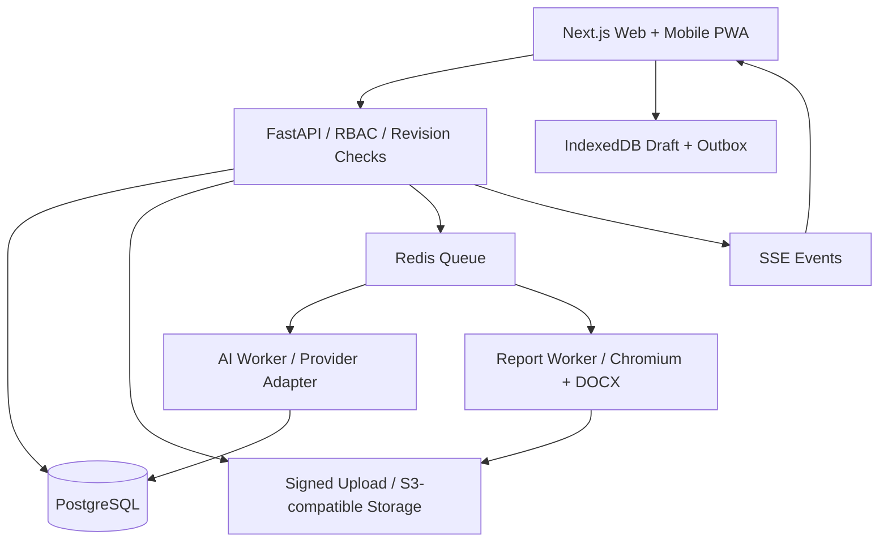
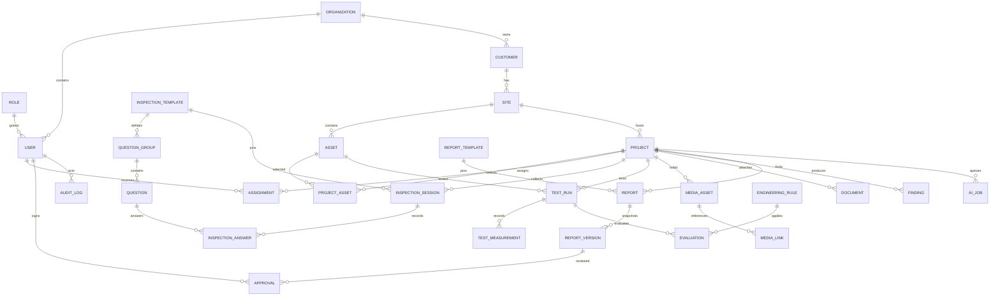

# IDC Smart Report Studio — MVP Development Specification

**แก้ไขตามต้นฉบับ:** ขนาดหน้าจริงเป็น Letter เป็นหลัก มี Landscape PM43/AGC25 และ A4 Scans AGC37–43 ใช้ Geometry ใน `dist/assets/templates/source-layout.json` เป็นหลักแทนข้อเสนอ A4 เดิมด้านล่าง ดู `TEMPLATE-AUDIT.md` สำหรับ Mapping ครบ100หน้า รุ่นเว็บล่าสุดมี Classic Layout5หมวดและ Reference Viewerครบเล่ม ยังไม่ได้สร้าง Editableครบทุกหน้า

ฉบับออกแบบ 1.0 · 29 ตุลาคม 2569 · เจ้าของงาน: IDC / Pakorn Technical Supply

## 1. ผลลัพธ์ที่ต้องส่งมอบ

ช่างบันทึกแบบตรวจ ค่าทดสอบ และรูปหลักฐานในโครงการเดียวกัน สำนักงานตรวจความครบถ้วนและจัดทำรายงาน วิศวกรตรวจผลและรับรองก่อนเผยแพร่ รายงานทุกฉบับต้องย้อนกลับไปยังข้อมูลและหลักฐานต้นทางได้

กระบวนการ: สร้างโครงการ → มอบหมาย → บันทึกหน้างาน → ส่งสำนักงาน → ตรวจทางวิศวกรรม → อนุมัติ → เผยแพร่ PDF / DOCX

ไฟล์ใน `dist/` เป็น **interactive frontend prototype** สำหรับตรวจ UX และ Data Flow ไม่ใช่ระบบ Production ตัวต้นแบบยังไม่มี API, Authentication, RBAC, AI ภายนอก, ซิงก์ข้ามเครื่อง, Digital Signature, DOCX หรือการรวม PDF ภาคผนวก ไม่มีการรับรองมาตรฐานโดยอัตโนมัติ

## 2. หลักฐานจากรายงานต้นแบบ

| แหล่งข้อมูล | สิ่งที่ตรวจพบ | ผลต่อการออกแบบ |
|---|---|---|
| PM.FP.69-151 ครัวการบินกรุงเทพ-เชียงใหม่, 56 หน้า | หน้า 3 แบ่งข้อมูลเบื้องต้น / ตรวจสอบ / ทดสอบ / สรุป | Template แยก Section และ Component |
| ฉบับเดียวกัน หน้า 6 | CLARKE JU4HNL24, PENTAIR 5X6X110, Rated 750 GPM, 109 PSI | แยก Asset Master กับผลตรวจแต่ละครั้ง |
| ฉบับเดียวกัน หน้า 7–10 | Checklist มี Y, N, None พร้อมหมายเหตุและภาพอุปกรณ์ | เก็บคำถามเป็น Schema และผูกรูปหลักฐาน |
| ฉบับเดียวกัน หน้า 44–46 | Discharge 116 / 86 PSI, 150% ไม่สามารถทดสอบ, อัตราสูงสุดจริงอธิบายเป็น 744 GPM | แยก Nominal Test Point, Actual Flow, NOT_TESTED และ Evaluation |
| PM.FP.69-095, AGC โรง C, 44 หน้า | หน้า 26: Discharge 150 / 135 / 115 PSI, Suction 0 / -6 / -10 PSI | รองรับแรงดันด้านดูดติดลบ และกราฟที่มาจากข้อมูลชุดเดียวกับตาราง |
| AGC หน้า 27–28 | มีข้อจำกัดในการสรุปบางเกณฑ์เพราะ Nameplate ไม่ระบุค่าบางจุด | ข้อมูลอ้างอิงไม่พอให้เป็น INCONCLUSIVE ห้ามเดาผล |
| ทั้งสองรายงาน | รูปเครื่องมือ ใบสอบเทียบ ข้อบกพร่อง และเอกสารผู้ประกอบวิชาชีพ | เก็บเอกสารแยกประเภท พร้อมสิทธิ์และ Metadata |

ใช้ PDF เป็นแหล่งวิเคราะห์โครงสร้างและ Golden Test Case ไม่ถือเป็นหลักฐานยืนยันมาตรฐานฉบับล่าสุด ตารางที่มีค่าจริงและข้อความอธิบายไม่ตรงกันต้องเก็บเป็น source discrepancy ให้วิศวกรยืนยัน ไม่แก้เงียบ ๆ ผลตรวจเดิมไม่ถูกโหลดเป็นผลของงานใหม่

ข้อความสกัดต้นฉบับอยู่ใน `docs/source-1.txt` และ `docs/source-2.txt` อาจมีช่องไฟภาษาไทยคลาดเคลื่อนจาก PDF การจับคู่ Question Bank ต้องทวนกับต้นฉบับก่อนใช้งานจริง ภาพ `dist/assets/fire-pump-reference.png` มาจาก PM.FP.69-151 หน้า 10 ใช้เป็นภาพอ้างอิงงานเดิมและระบุที่มาใน Caption

## 3. ผู้ใช้และสถานะ

| Role | สิทธิ์หลัก | ข้อจำกัด |
|---|---|---|
| Technician | ดูงานที่มอบหมาย กรอกคำตอบ อัปโหลดหลักฐาน ส่งผลหน้างาน | ไม่รับรองหรือเผยแพร่ |
| Office | จัดการโครงการ ตรวจข้อมูล แก้ร่าง จัดรูปและส่งตรวจ | ไม่ลงนามแทนวิศวกร |
| Supervisor | ตรวจความครบถ้วน ส่งกลับหรือส่งต่อ | ไม่แก้ Snapshot ที่ล็อกแล้ว |
| Engineer | ตรวจผลคำนวณและข้อมูลอ้างอิง รับรองเวอร์ชัน | ต้องยืนยันตัวตนและลงนามด้วยอำนาจจริง |
| Admin | จัดการผู้ใช้ Template และกฎมาตรฐาน | การเป็น Admin ไม่ให้สิทธิ์รับรองโดยอัตโนมัติ |
| Viewer | อ่านรายงาน Published ที่ได้รับอนุญาต | ห้ามเข้าถึง Draft และเอกสารส่วนบุคคล |

สถานะ Production:

`DRAFT → ASSIGNED → IN_PROGRESS → FIELD_SUBMITTED → OFFICE_REVIEW → ENGINEER_REVIEW → APPROVED → PUBLISHED → ARCHIVED`

ส่งกลับ: `OFFICE_REVIEW / ENGINEER_REVIEW → RETURNED → IN_PROGRESS / OFFICE_REVIEW` โดยบันทึกผู้รับผิดชอบ จุดที่ต้องแก้ และเหตุผลทุกครั้ง

การเปลี่ยนสถานะเป็นคำสั่งฝั่ง Server ตรวจสิทธิ์ โครงการ Revision และ Validation ใน Transaction เดียวกัน ไม่รับสถานะใหม่จาก Client โดยตรง การแก้หลัง APPROVED ต้องสร้าง Revision ใหม่ โดยฉบับเผยแพร่เดิมยังดาวน์โหลดได้เหมือนเดิม

ต้นแบบย่อสถานะเป็น DRAFT / SUBMITTED / RETURNED / APPROVED และระบุว่าเป็นการทดลอง ไม่มี Published หรือการรับรองจริง

## 4. UX และ Design System

Desktop: Sidebar 226px, Topbar 70px, Workspace, Context Panel ตามงาน หน้าจอ Report Builder แบ่ง Content Editor / A4 Preview สัดส่วนประมาณ 40:60

Mobile: แสดงฟอร์มเป็นหลัก เมนูล่าง งาน / แบบตรวจ / ภาพ / รายงาน ขนาดเป้าสัมผัส Production ไม่น้อยกว่า 44px ปุ่มตอบผลมีข้อความ ไม่ใช้สีอย่างเดียว สลับ Editor / Preview ได้ในจอเล็ก

สี: Navy #17345C, Blue #2469A8, Sky #E9F4FC, Background #F7F9FC, Accent #F28C45; Green = ปกติ, Red = ผิดปกติ, Amber = ต้องตรวจทาน, Gray = ยังไม่มีข้อมูล

Typography: IBM Plex Sans Thai สำหรับ UI, Sarabun สำหรับเอกสาร Production; ต้นแบบใช้ IBM Plex Sans Thai และ Manrope พร้อม System Font fallback ต้องเก็บฟอนต์ภายในระบบเมื่อทำ PWA เพื่อใช้งานออฟไลน์เต็มรูปแบบ

Accessibility: Form Label ครบ, Keyboard Navigation, Focus Visible, Status Message สำหรับ Screen Reader, Contrast ตาม WCAG AA, แจ้ง Error ข้างช่องและมีสรุปพร้อมลิงก์ไปแก้ ไม่บังคับให้ผู้ใช้ตีความสี

### หน้าจอทั้ง 15 หน้า

| # / หน้าจอ | ส่วนประกอบและพฤติกรรม | Empty / Error / สิทธิ์ |
|---|---|---|
| 01 Dashboard | KPI จากงานจริง รายการงานล่าสุด Filter ตามทีม สถานะ วันครบกำหนด ปุ่มสร้างงาน | ไม่มีงานแสดง CTA สร้างโครงการ; KPI นับเฉพาะงานที่มีสิทธิ์ |
| 02 Project List + Wizard | ค้นหารหัส ลูกค้า สถานที่; Wizard เลือกลูกค้า Site Asset Template วันที่ ทีม รหัสงาน | รหัสซ้ำต้องแจ้งก่อนสร้าง; ใช้ Create Idempotency Key |
| 03 Customer & Asset 360 | ข้อมูลลูกค้า Site Nameplate Serial Rated Flow/Pressure Baseline ประวัติงาน ปุ่มสร้างงานปีถัดไป | ช่องอ้างอิงไม่ครบต้องแจ้ง; คัดลอกเฉพาะ Master Data |
| 04 Technician Worklist | Assigned Today / In Progress / Returned, Progress และ Sync State | ไม่มีงานแสดงสถานะชัด; ไม่แสดงงานทีมอื่น |
| 05 Field Checklist | Question Group, Y/N/None/Not Inspected, Number, Remark, Evidence; Autosave | N ต้องมีรายละเอียด; Required Questions ต้องตอบก่อนส่ง |
| 06 Field Camera & Gallery | กล้อง/หลายไฟล์ Grid Preview Category Caption Link to Question ลบ/ย้ายภาพตามสิทธิ์ | Upload Progress, Retry, Duplicate Hash, Blur Suggestion; ห้ามลบภาพที่อยู่ในฉบับรับรอง |
| 07 Test Data Entry | Test Run, Point, Actual Flow, Discharge, Suction, RPM, Temperature, Instrument, Unit | NOT_TESTED ไม่รับค่าที่ใช้คำนวณ; Suction ติดลบได้; Flow ห้ามติดลบ |
| 08 Document & Calibration | ประเภทเอกสาร ชื่อเครื่องมือ Certificate No Calibration/Due Date ต้นฉบับ Review | หมดอายุตามเงื่อนไขงานต้องเตือน/Block; OCR ต้องยืนยัน |
| 09 Office Inbox & QA | งานช่างส่งมา Checklist ความครบถ้วน รายการปัญหา Deep Link หลักฐาน ปุ่มส่งกลับ | ไม่ใช้ความครบถ้วนแทนผลผ่านมาตรฐาน; ระบุเหตุผลส่งกลับ |
| 10 AI Report Builder | Section Navigator, Content/Photos/Settings, A4 Preview, Page Count, Source Drawer, AI Draft Review | ข้อมูลขาดแสดง Placeholder; Render Error คงข้อมูลกรอกไว้ |
| 11 Template Library | PM-FP-001 / PT-FP-001 Preview Scope Version ปุ่มใช้เทมเพลต | เลือกได้เฉพาะ Published Version; งานเก่าไม่เปลี่ยนเมื่อเทมเพลตออกใหม่ |
| 12 Template Designer | Component List, Ordering, Page Layout, Data Binding, Conditions, Required Evidence | MVP ใช้ Fixed Components; Full Drag and Drop ระยะถัดไป; Admin Only |
| 13 Engineering Review | ค่าดิบ ค่าคำนวณ Baseline Rule Clause/Edition ผลประเมิน Findings และ Evidence Side by Side | ไม่มี Baseline ให้ INCONCLUSIVE; Engineer ยืนยันแต่ละจุดสำคัญ |
| 14 Approval & Publishing | Reviewer Queue, Comment, Return, Approve, Signature Verification, PDF/DOCX, Versions | ห้ามเผยแพร่ Draft; Revision Mismatch ต้องให้โหลดข้อมูลใหม่ |
| 15 Settings & Audit | Users/Roles Organization AI Provider Rules Template Versions Audit Filters Backup Policy | Admin Scoped; Log เป็น Append-only; ปกปิดข้อมูลส่วนบุคคลตามสิทธิ์ |

หมายเลขหน้าจอเป็น Screen Inventory สำหรับพัฒนา รายละเอียด Wizard และ Asset เป็นหน้าหรือ Modal ได้ตามขนาดจอ ต้นแบบรวม Engineering Review กับ QA เพื่อทดลองโฟลว์

### การใช้งานที่ต้องสั้น

ช่าง: เปิดงาน → ตอบคำถาม → เพิ่มรูป → บันทึกค่าจริง → ส่งสำนักงาน ต้องเห็นว่าเหลือหมวดใดและข้อมูลบันทึกแล้วหรือยัง

สำนักงาน: เปิด Inbox → แก้ Missing Data → เลือกรูปหลัก → ตรวจสรุป → ตรวจพรีวิว → ส่งวิศวกร ผู้ใช้ไม่ต้องคัดลอกข้อมูลลง Word ซ้ำ

สร้างงานจากเดิม: ลูกค้า/Site/Asset/Template ใช้ซ้ำ; Answers/Test Runs/Findings/Photos/Approvals เริ่มใหม่ เอกสารเดิมเสนอเป็นรายการให้ทวนวันหมดอายุ ไม่แนบรับรองโดยอัตโนมัติ

## 5. ฟอร์มและ Template Schema

Question Version ระบุ `code, label, group, answer_type, unit, required, validation, evidence_rule, position` ประเภทคำตอบ: SINGLE_SELECT, NUMBER, TEXT, PHOTO, BOOLEAN, DATE, ATTACHMENT, REPEATABLE

`None` ในรายงานเดิมหมายถึง “ไม่ได้ติดตั้ง” ต้องแยกจาก “ไม่เกี่ยวข้อง” และ “ไม่ได้ตรวจ” ใน Production ห้ามใช้ค่าเดียวแทนทุกความหมาย ต้นแบบแสดงตัวเลือกย่อเพื่อทดลอง UX ก่อนทวน Question Bank ฉบับจริง

ตัวอย่าง:

```json
{
  "code": "ROOM_003", "version": 1,
  "label": "การระบายอากาศภายในห้องเครื่อง",
  "answer_type": "SINGLE_SELECT", "required": true,
  "options": ["NORMAL", "ABNORMAL", "NOT_INSTALLED", "NOT_APPLICABLE", "NOT_INSPECTED"],
  "validation": {"remark_required_when": ["ABNORMAL", "NOT_INSPECTED"]},
  "evidence_rule": {"min_photos_when_abnormal": 1}
}
```

Report Components: CoverBlock, FieldBlock, TextBlock, SpecificationBlock, ChecklistBlock, ImageGridBlock, TestDataBlock, ChartBlock, FindingBlock, AttachmentBlock, SignatureBlock, TableOfContentsBlock

```json
{
  "code":"PM-FP-001", "version":"1.0.0", "status":"PUBLISHED",
  "page":{"size":"A4","orientation":"portrait","margin_mm":[15,16,15,16]},
  "sections":[
    {"id":"cover","component":"CoverBlock","bindings":{"customer":"project.customer.name","photo":"report.cover_media_id"}},
    {"id":"room","component":"ChecklistBlock","question_group":"FIRE_PUMP_ROOM","required":true},
    {"id":"performance","component":"TestDataBlock","data_source":"test_runs.confirmed","include_chart":true},
    {"id":"findings","component":"FindingBlock","repeatable":true},
    {"id":"appendix","component":"AttachmentBlock","data_source":"documents.verified"}
  ]
}
```

Schema Binding ใช้ Allowlist Path ห้ามรัน JavaScript ที่ผู้ดูแลกรอก HTML ต้อง Sanitize Template Published แก้ไม่ได้ สร้าง Version ใหม่แล้วตรวจ Preview ก่อนเผยแพร่

## 6. Calculation และ AI Contract

ค่าทดสอบเก็บ Decimal พร้อมหน่วย; `point_percent` เป็นจุดที่ตั้งใจทดสอบ, `actual_flow_gpm` เป็นค่าที่วัดจริง ไม่อนุมานว่าจุด 100% = 750 GPM เสมอ

`test_status = PENDING | TESTED | NOT_TESTED | INVALID`

`evaluation_status = PENDING_REVIEW | PASS | FAIL | INCONCLUSIVE`

NOT_TESTED ต้องมีเหตุผล ไม่ใส่ศูนย์แทน ไม่ลากกราฟข้ามจุดที่ขาด เก็บ Raw Measurement และ Normalized Measurement แยกพร้อมสูตร/Conversion Version

Water Reserve ตัวอย่างต้นฉบับ: `750 × 30 × 3.78 = 85,050 L = 85.05 m³` ใช้เป็น Golden Arithmetic Example เท่านั้น ตัวคูณและเวลาเป็น Rule Parameters ที่ผู้มีอำนาจต้องรับรอง ไม่ใช่เกณฑ์อัตโนมัติจาก LLM

Rule Record: `standard_name, edition, clause, effective_from, parameters, calculation_type, version, approved_by, approved_at, status` ผลคำนวณบันทึก Inputs Outputs Rule Version และ Explanation

AI Modules: Classification, OCR, Caption, Findings/Recommendation Draft, Summary, Completeness Check

AI Result:

```json
{
  "job_id":"uuid", "type":"REPORT_SUMMARY",
  "status":"SUGGESTED", "text":"ร่างข้อความ",
  "source_references":[{"entity_type":"inspection_answer","id":"uuid"}],
  "model":"provider/model", "prompt_version":"1", "confidence":null,
  "confirmed_by":null, "confirmed_at":null
}
```

ผู้ใช้ยืนยันก่อน OCR เติมค่าจริง แสดงภาพต้นทางและค่าที่อ่านได้แยกจากค่าปัจจุบัน AI ห้ามตัดสินรับรอง ห้ามสร้างตัวเลขที่ขาด ห้ามลงนาม และไม่มีสิทธิ์เรียก Publish โดยตรง Provider Timeout/Quota ต้อง Retry ได้โดยไม่ทำงานซ้ำ และไม่บล็อกการบันทึกฟอร์ม

## 7. สถาปัตยกรรมตาม Blueprint



เริ่ม Modular Monolith แยก Domain Modules, Background Workers ประมวลผลรูป/AI/เอกสาร Backend ใช้ FastAPI/Pydantic/SQLAlchemy ตามโจทย์ Frontend ใช้ Next.js/TypeScript/Tailwind และ Design Components; Charts ใช้ ECharts ตาม Blueprint

Deployment MVP: Docker Compose, Reverse Proxy TLS, Web, API, Worker, PostgreSQL, Redis, Object Storage Migration ต้องรันแยกจาก App Start และมี Health Checks ไม่กำหนดเวอร์ชันล่าสุดในเอกสารนี้ ให้ล็อกเวอร์ชันที่ทดสอบใน Implementation Sprint

## 8. Database ERD และข้อกำหนด



| Table | ฟิลด์และข้อกำหนดสำคัญ |
|---|---|
| organizations | uuid, name, settings_json, status |
| users / roles | organization_id, identity_subject, name, email; role_permissions + project scope |
| customers / sites | org_id, name, tax_id, contact; site customer FK และที่อยู่ |
| assets | site_id, type, brand, model, serial_no, specifications_json, baseline_document_id |
| projects | org_id, site_id, code, date, status, revision, created_by; unique(org_id, code) |
| project_assets / project_assignments | project_id + asset_id / user_id, role, scope |
| inspection_templates | code, version, schema_hash, status; unique(org_id, code, version) |
| question_groups / questions | versioned template FK; stable code + answer schema + validation |
| inspection_sessions | project_id, template_version_id, technician_id, status, revision |
| inspection_answers | session_id, question_id, value_json, remark, actor, timestamps; unique(session_id, question_id) |
| test_runs | project_id, asset_id, instrument_id, performed_at, test_type |
| test_measurements | test_run_id, point_code, metric, decimal_value, unit, test_status, reason |
| evaluations | test_run_id, rule_version_id, inputs_json, outputs_json, status, reviewed_by |
| media_assets | project_id, original_key, thumbnail_key, mime, bytes, sha256, captured_at, uploaded_by |
| media_links | media_id, question/answer/finding/report block FK, placement, caption, position |
| documents | project_id, type, storage_key, sha256, certificate_no, calibrated_at, expires_at, verification_status |
| findings | project_id, source_answer_id, severity, description, recommendation, confirmed_by |
| report_templates | code, version, layout_schema, status, published_by |
| reports | project_id, report_no, template_version_id, current_version_id, status |
| report_versions | report_id, version_no, snapshot_json, snapshot_hash, template_version, rule_versions, pdf_key, docx_key |
| approvals | report_version_id, reviewer_id, role, decision, reason, auth_evidence_ref, signed_at |
| engineering_rules | standard, edition, clause, config, version, approved_by, status |
| ai_jobs | org_id, project_id, type, input_refs, result_json, model, prompt_version, status, attempts |
| audit_logs | org_id, actor_id, entity FK, action, before_json, after_json, request_id, created_at |

ใช้ UUID, UTC timestamptz, Decimal ไม่ใช้ Float สำหรับผลคำนวณ กำหนด Composite FK หรือ Tenant Check ป้องกันเชื่อมข้อมูลคนละองค์กร Question FK ต้องตรงกับ Template Version ของ Session

Polymorphic media_links ต้องมีข้อจำกัดว่าเป้าหมายมีอยู่จริงและอยู่โครงการเดียวกัน อาจแยก link tables เพื่อบังคับ FK โดยตรง

Report Version เป็น Immutable Snapshot รวมข้อมูล ภาพ/Caption ตำแหน่งหน้า และ Storage Object Version การแก้ข้อมูล Master ไม่เปลี่ยนรายงานเก่า ห้าม Hard Delete หลักฐานที่ถูก Snapshot อ้างอิง; Soft Delete พร้อม Audit ตาม Retention Policy

## 9. API Contract

Base `/api/v1`, Auth Cookie แบบ HttpOnly/Secure + CSRF Protection หรือ Identity Token ตามระบบองค์กร ทุก Endpoint ตรวจ Tenant/Project Scope ฝั่ง Server

| Method | Endpoint | หน้าที่ |
|---|---|---|
| POST | /auth/login | เข้าสู่ระบบผ่าน Identity Provider |
| GET / POST | /projects | ค้นหาแบบ Cursor Pagination / สร้างงาน |
| GET / PATCH | /projects/{id} | อ่าน / แก้ข้อมูลด้วย If-Match Revision |
| POST | /projects/{id}/clone | ใช้ Asset Master เริ่มผลตรวจใหม่ |
| POST | /projects/{id}/assignments | มอบหมายผู้ปฏิบัติงาน |
| GET | /projects/{id}/inspections | Sessions และความคืบหน้า |
| POST | /inspections/{id}/answers:batch | Patch คำตอบพร้อม Revision และ Idempotency |
| POST | /projects/{id}/media/upload-intents | Signed URL จำกัด Object Key/Type/Size |
| POST | /projects/{id}/media/complete | Verify Storage, Hash และสร้าง Worker Job |
| POST | /projects/{id}/documents | ลงทะเบียนเอกสารพร้อมประเภทและวันสอบเทียบ |
| POST | /test-runs | สร้างชุดทดสอบ |
| PUT | /test-runs/{id}/measurements | บันทึกค่าจริง/หน่วย/สถานะ |
| POST | /test-runs/{id}/evaluate | ประเมินด้วย Rule Version ที่อนุมัติ |
| GET | /templates | Template Published และ Schema |
| POST | /reports | สร้างร่างจาก Project + Template Version |
| POST | /reports/{id}/render | Queue Render; ตอบ 202 พร้อม Job ID |
| GET | /reports/{id}/versions | ประวัติเวอร์ชันและ Hash |
| POST | /reports/{id}/submit-review | ตรวจความครบถ้วนและส่งตาม Workflow |
| POST | /reports/{id}/approvals | ตรวจสิทธิ์ Revision และยืนยันการรับรอง |
| POST | /reports/{id}/publish | เผยแพร่เฉพาะ Snapshot ที่อนุมัติ |
| GET | /reports/{id}/download | Signed Download URL ตามสิทธิ์ |
| POST / GET | /ai/jobs, /ai/jobs/{id} | Queue / Poll AI Job |
| GET | /events | SSE เฉพาะเหตุการณ์ที่ผู้ใช้มีสิทธิ์ |

Batch Request:

```json
{"answers":[{"question_code":"ROOM_003","value":"ABNORMAL","remark":"อยู่ใต้อาคาร","media_ids":["uuid"]}],"client_revision":8,"idempotency_key":"device-request-uuid"}
```

Response:

```json
{"revision":9,"saved_at":"2026-10-29T07:00:00Z","validation_errors":[],"conflicts":[],"accepted_ids":["uuid"]}
```

HTTP 409 สำหรับ Revision Conflict ส่งค่าฝั่ง Server และรายการฟิลด์ที่ขัดแย้ง ไม่เขียนทับอัตโนมัติ HTTP 422 สำหรับข้อมูลผิด; 403 สำหรับไม่มีสิทธิ์; 404 ไม่เปิดเผย Entity ของ Tenant อื่น; 429/503 ให้ Retry ตาม Backoff

SSE: `inspection.updated`, `media.processed`, `ai_job.completed`, `report.preview_ready`, `review.returned`, `report.approved` พร้อม Event ID สำหรับ Resume ห้าม Broadcast ข้อมูลข้ามองค์กร

## 10. Offline และ Concurrency

IndexedDB เก็บ Draft, Pending Uploads, Outbox และ last_server_revision ทุก Action มี UUID/Idempotency Key เมื่อออนไลน์ส่งเป็นลำดับและลบ Outbox หลัง Server ยืนยันเท่านั้น ขนาดภาพใช้ Quota Estimate พร้อมเตือนก่อนเต็ม

Sync State: Saved Locally / Syncing / Synced / Conflict / Failed แสดงจำนวนงานค้าง Service Worker cache App Shell และ Versioned Form Schema เพื่อเปิดแอปโดยไม่มีเน็ตได้ ห้ามแสดง “ซิงก์แล้ว” เพียงเพราะออนไลน์

กรณีสำนักงานกับช่างแก้ฟิลด์เดียวกัน แสดงค่า Local / Server / ผู้แก้ / เวลา ให้เลือก Merge พร้อม Audit การสลับโครงการระหว่าง Upload ต้องผูกรูปกับ project_id ตอนเริ่มอัปโหลด

## 11. Report Rendering

Pipeline: ตรวจ Validation → ยืนยันข้อมูล → สร้าง Immutable Snapshot → Resolve Template/Rule Versions → Render HTML → Paginate → TOC/Figure/Table Numbers → PDF/DOCX → Verify Outputs → Hash → Storage → Review

Image Layout: 1, 2, 3, 4, 6, 9 ภาพต่อกลุ่ม ตามสัดส่วนจริง ไม่ยืดภาพและไม่ Crop หลักฐานโดยไม่มีคำสั่งผู้ใช้ Caption กับภาพต้องอยู่หน้าเดียวกัน ตารางยาวมีหัวตารางซ้ำ Page Break ไม่แยกหัวข้อออกจากเนื้อหา หน้ากว้างใช้ Landscape เฉพาะ Section

Live Preview ใช้ Rendered HTML ที่ผูกข้อมูลเดียวกับ Export; Full PDF ทำใน Worker และแจ้งผ่าน SSE ใช้ Font Files เดียวกันสำหรับ Preview/Worker ไม่แสดง PDF ที่ยังสร้างไม่เสร็จเป็นฉบับพร้อมดาวน์โหลด

DOCX ใช้ Semantic Heading/Table/Image/Section Break ไม่ใช้ภาพทั้งหน้าทดแทนเอกสารแก้ไขได้ PDF กับ DOCX ต้องเทียบข้อมูล รูป Caption และจำนวนรายการ ไม่รับประกัน Pagination เท่ากันทุกโปรแกรม Word

ต้นแบบปัจจุบันพิมพ์ A4 ผ่าน Browser แบ่งภาพ 4 รูปต่อหน้า ข้อความยาวและตารางต้องตรวจ Print Preview ยังไม่มี TOC / Pagination Engine ที่รับประกันแบบ Production

## 12. ความปลอดภัยและการรับรอง

Tenant Isolation, RBAC + Project Scope, HTTPS, Encryption at Rest, Signed URLs, Content Type Verification, Upload Malware Scan, Audit Append-only, Session Expiry, Rate Limiting, Backup/Restore และ Retention Policy

AI ใช้ข้อมูลเท่าที่จำเป็น ไม่ส่งใบอนุญาต/ข้อมูลส่วนบุคคลที่ไม่เกี่ยวข้อง เก็บ Prompt/Model Version และข้อตกลง Provider ตามนโยบายองค์กร

Signature ต้องมี Authentication Evidence, Signer Identity, เวลา, Document Hash และ Authority Scope ห้ามวางรูปลายเซ็นอัตโนมัติจาก Draft การ Publish ทำหลัง Approval ที่ตรง Snapshot Hash เท่านั้น

## 13. Backlog และเกณฑ์รับมอบ

| Sprint | Deliverable | Exit Criteria |
|---|---|---|
| 1 Foundation | Auth/Roles, Org/Customer/Site/Asset/Project, Migrations | สร้างและมอบหมายงานได้ Tenant Test ผ่าน |
| 2 Field | Versioned Form, Photos, Test Entry, PWA/Outbox/Conflict | Offline Draft ไม่หาย อัปโหลดไม่สลับโครงการ |
| 3 Reports | 2 Templates, Binding, Pagination, Charts, PDF/DOCX | ภาพ/ตัวเลข/ตารางครบจาก Snapshot เดียวกัน |
| 4 Review/AI | QA, Rules, AI Draft Confirmation, Approval/Audit | ไม่เผยแพร่ข้ามขั้นตอน ไม่แก้ฉบับรับรอง |
| 5 Pilot | Golden Cases, Security/Restore, Training | UAT ทั้งสองรายงานผ่าน พร้อมผู้ใช้ตรวจรับ |

Phase 2: Full Template Designer, AI Photo/OCR ขั้นสูง, Approved Knowledge Base, Customer Portal, Analytics ข้ามปี ไม่อยู่ในเกณฑ์ MVP ขั้นพื้นฐาน

### UAT

1. สร้างงานจากลูกค้าเดิมแล้วผลตรวจ/ภาพ/ลายเซ็นไม่ติดมาด้วย
2. กรอกแบบตรวจขณะออฟไลน์ ปิดเปิดแอปใหม่ ข้อมูลยังอยู่และ Sync ได้
3. อัปโหลดชุดภาพพร้อมสลับโครงการ ภาพต้องไม่สลับงาน
4. ตอบผิดปกติ รายงานแสดงข้อบกพร่องและหมายเหตุ ไม่แปลงเป็นปกติ
5. ทดสอบ 150% ไม่ได้ รายงานแสดงเหตุผล ไม่มีศูนย์หรือจุดกราฟที่แต่งขึ้น
6. กรณี AGC 150/135/115 PSI และ Suction 0/-6/-10 ตรงกันในฟอร์ม ตาราง กราฟ
7. กรณีไม่มี Baseline เพียงพอ ผลเป็น INCONCLUSIVE ตามกฎที่รับรอง
8. กรณีครัวการบิน Actual Flow 744 GPM แยกจาก Nominal 750 และมีรายการ discrepancy ให้ตรวจ
9. เพิ่มรูปเกินหนึ่งหน้า รูป/Caption/เลขหน้าครบ ไม่มีส่วนที่ถูกตัด
10. ส่งกลับแก้ไขมีเหตุผล ช่างเห็นรายการและประวัติ
11. อนุมัติแล้วแก้ข้อมูลต้นทาง ฉบับรับรองเดิมต้องมี Hash และเนื้อหาเดิม
12. PDF/DOCX มีจำนวนรายการเท่ากัน เปิดตรวจในเครื่องลูกค้าได้
13. ผู้ใช้คนละองค์กรอ่าน/อัปโหลด/ดาวน์โหลด/รับ SSE ของงานอื่นไม่ได้
14. Revision Conflict ไม่ทำข้อมูลอีกฝ่ายหาย
15. Calibration หมดอายุแสดงตามเงื่อนไขและต้องผ่านผู้ตรวจ
16. Worker ล้ม/Retry ไม่สร้าง Version หรือรายการ Upload ซ้ำ
17. Restore Database และ Object Storage แล้วเปิดรายงาน/หลักฐานเดิมได้

Acceptance Gate: ไม่มีข้อมูลหรือหลักฐานสูญหาย ไม่มีตัวเลขที่ AI สร้างขึ้นเอง ไม่มีการรับรองหรือเผยแพร่ข้ามสิทธิ์ และ Golden Test Cases สองฉบับผ่านการตรวจโดยพนักงานสำนักงานและวิศวกรจริง

## 14. สิ่งที่ต้องยืนยันก่อน Production

Word ต้นฉบับและ Checklist เปล่าฉบับบริษัท; Question Bank ทั้งหมด; โครงสร้างรหัสงาน; ผู้มีอำนาจตรวจ/ลงนาม; Rule Set พร้อม Edition/Clause ที่อนุมัติ; เอกสารสิทธิ์และนโยบายใช้รูป/AI; Retention/Backup RPO/RTO; Pilot Hardware/Browser; รูปแบบ Classic/Modern ที่ลูกค้ายอมรับ
